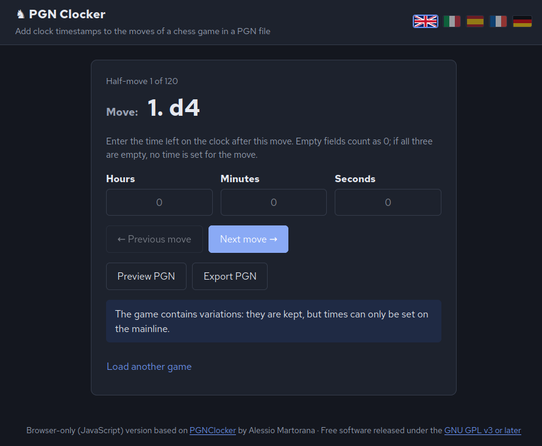

# PGNClocker-Web

## Description
PGNClocker-Web is a simple web application to add clock timestamps to moves of a chess game in a PGN file, making easier to add timestamps to many moves (for example all of the moves of the game) without requiring to open the PGN manually and copy/paste the PGN tag used for the clock timestamps.
The program is particularly useful in case the software/service you use to analyze chess games does not allow to insert clock timestamps natively (es: [lichess.org](https://lichess.org))
This is the web version of the standalone project: [pgnclocker](https://gitlab.com/deperito/pgnclocker). 

Load (or paste) a game in PGN format, go through the moves one at a time by entering the time remaining on the clock, and download the PGN with `[%clk h:mm:ss]` annotations — useful, for example, for seeing how much time was spent thinking about certain moves or for importing the game into a Lichess study.



## How to launch it

Open `index.html` with a double-click (or drag it into a browser window). That's all there is to it.

Designed for modern browsers; tested in Chromium (the engine behind Chrome and Edge), but not in Firefox or Safari.

If you prefer to host it on a website, copy the entire folder to any static file hosting service (GitHub Pages, Netlify, a basic web hosting service, etc.): there's nothing to configure.

## How to use it

1. Upload the PGN file or paste the text.
2. The main window displays the **current move** and three fields: **hours, minutes, seconds**. Any empty field is treated as 0. If all three fields are empty, no time is assigned to that move (and any existing `[%clk]` annotation is removed). Minutes and seconds must be between 0 and 59.
3. **Next move** saves the time and advances to the next move (focus automatically moves to this button); **Previous move** goes back. Pressing Enter in a field has the same effect as clicking Next move (on the last move, it opens the preview).
4. **Preview PGN** displays a table of moves with the assigned time next to each one (blank if no time is set). Clicking a move returns to the main window at that move.
5. **Export PGN** generates the PGN with clock times: you can download it (choosing the filename) or copy it.

Any clock times already present in the PGN (`[%clk ...]`) are read and displayed in the fields.

## Languages and move notation

The interface defaults to **English**; clicking the flags at the top switches to **Italian**, **Spanish**, **French**, or **German**. Your choice is remembered by the browser, and switching languages does not discard your current work.

Moves are displayed in all languages using **piece symbols** instead of letters (♔ ♕ ♖ ♗ ♘): for example, `♗g7` instead of `Bg7`, `♘f3` instead of `Nf3`. This also applies to promotions (`e8=♕`); pawn moves, captures, checks, and castling remain unchanged.

The exported PGN always uses standard English notation, as required by the PGN format and expected by tools such as Lichess studies.

## Where data is stored

All data (game, entered times, current move, and language) is stored only in your browser's `localStorage`, so refreshing the page won't cause you to lose your work. **Load another game** / **New game** clears the saved game. Nothing is ever sent outside your computer.

## Project structure

| File | Purpose |
|---|---|
| `index.html` | Single page: loads the scripts and contains only an empty container |
| `css/style.css` | Styling (with automatic dark mode) |
| `js/clock.js` | Hours / minutes / seconds conversion and validation |
| `js/pgn.js` | PGN parsing, `[%clk]` annotation reading and writing, and export |
| `js/i18n.js` | Languages, translations, piece symbols, and flags |
| `js/lang/*.js` | String catalogs (`en`, `it`, `es`, `fr`, `de`) |
| `js/app.js` | Interface: screens, navigation, events, and persistence |
| `tests/run.js` | Logic tests (Node) |
| `tests/e2e.js` | Browser tests (Playwright), opens the page from `file://` |

The scripts are classic scripts (no ES modules or network requests), specifically because when opening the page with a double-click, browsers do not allow modules to be loaded from `file://`.

## Adding a language

1. Copy `js/lang/en.js` to `js/lang/<code>.js`, change `ns.lang.en` to `ns.lang.<code>`, and translate the values.
2. Add the line `<script src="js/lang/<code>.js"></script>` to `index.html`.
3. Add the language code (and language name) to `LANGUAGES` in `js/i18n.js`, and add the corresponding flag in `flagSvg()`.

## Tests

```bash
node tests/run.js                              # logic: no dependencies
npm i playwright && node tests/e2e.js          # UI in a real browser (requires Chromium)
```

## Support
Please refer to this PGNClocker-Web [repository](https://github.com/deperito/pgnclocker-web/) for new features requests and bug reports. 

If you need further support, feel free to contact me directly at alessiomartorana22[at]gmail.com

## License
PGNClocker-Web is licensed under the GPL 3 (or any later version at your option)\


